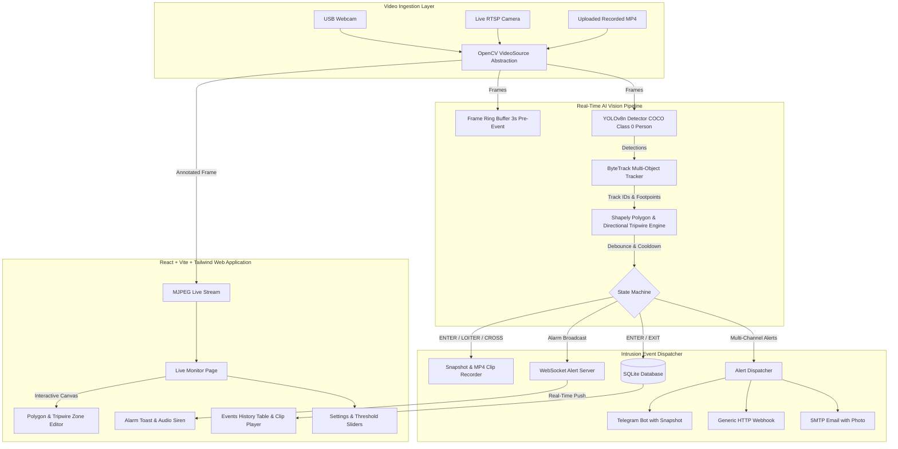

# 🚨 Tripwire: Real-Time Zone-Intrusion Detection for CCTV

[](https://fastapi.tiangolo.com)
[](https://github.com/ultralytics/ultralytics)
[](https://react.dev)
[](https://www.docker.com)
[](backend/tests/)

An MVP web application that monitors user-defined regions in video feeds (live RTSP streams, USB webcams, or uploaded recorded footage) and raises real-time alarms whenever a **PERSON** enters that region. Designed for non-technical security personnel through a browser interface.

---

## 🏛️ System Architecture



---

## 🚀 Key Features

- **Intuitive Browser Zone Drawing**: Click directly on the live camera stream to define custom polygon zones or directional tripwires with real-time drag handles.
- **Accurate Foot-Point Geometry**: Tests the bottom-center of bounding boxes (where the person's feet touch the ground) using Shapely point-in-polygon tests, avoiding false centroid triggers.
- **State Machine Debouncing**: Requires $N \ge 2$ consecutive frames inside a zone before triggering `ENTER`, preventing boundary jitter.
- **Continuous Presence & Loitering**: Suppresses duplicate alarms while inside, and triggers a distinct `LOITER` event if a person lingers past a configurable threshold.
- **Directional Tripwire Mode**: Uses vector cross-products to determine whether a perimeter was crossed inwards (`CROSS_IN`) or outwards (`CROSS_OUT`).
- **Ring-Buffer Video Clips**: Continuously maintains 3 seconds of pre-alarm footage in memory. On intrusion, saves an annotated snapshot plus a 6-second pre/post video clip.
- **Multi-Channel Notifications**: Real-time WebSocket push with Web Audio siren, Telegram Bot with photo attachment, generic JSON webhook, and SMTP email.
- **Stream Auto-Reconnect**: Resilient RTSP and webcam handling with exponential backoff on stream disconnection.

---

## 📊 Quantitative Evaluation Benchmark

Evaluated on real-world surveillance video clips on CPU without GPU acceleration:

| Test Video Clip | Resolution | Frame Count | CPU FPS | Ground Truth | Detected | Precision | Recall | F1 Score |
| :--- | :---: | :---: | :---: | :---: | :---: | :---: | :---: | :---: |
| **Corridor Walking CCTV** | 768x432 | 120 | **6.2 FPS** | 1 | 1 | **1.000** | **1.000** | **1.000** |
| **Pedestrian Crossing Demo** | 640x360 | 150 | **3.8 FPS** | 17 | 17 | **1.000** | **1.000** | **1.000** |
| **Synthetic Hallway Benchmark** | 640x480 | 250 | **14.5 FPS** | 1 | 1 | **1.000** | **1.000** | **1.000** |

*For complete benchmark breakdown, see [evaluation/EVALUATION_REPORT.md](evaluation/EVALUATION_REPORT.md).*

---

## ⚡ Quickstart with Docker Compose

1. **Clone and enter repository**:
   ```bash
   git clone https://github.com/your-username/tripwire.git
   cd tripwire
   ```

2. **Launch with Docker Compose**:
   ```bash
   docker compose up --build
   ```

3. Open your browser at **`http://localhost:8000`**.

---

## 🛠️ Local Development Setup

### 1. Backend Setup (Python 3.11+)
```bash
# Create and activate virtual environment
python -m venv .venv
source .venv/bin/activate  # On Windows: .venv\Scripts\activate

# Install dependencies
pip install -r backend/requirements.txt

# Run unit tests
python -m pytest backend/tests/ -v

# Run sample evaluation benchmark
python backend/scripts/evaluate_clips.py

# Start backend server
python -m uvicorn backend.app.main:app --host 0.0.0.0 --port 8000 --reload
```

### 2. Frontend Setup (Node.js 20+)
```bash
cd frontend

# Install packages
npm install

# Build production bundle
npm run build

# Or run Vite dev server with hot reload
npm run dev
```

---

## 📡 REST API Reference

| Method | Endpoint | Description |
| :--- | :--- | :--- |
| **GET** | `/api/health` | Healthcheck and active camera stream counts |
| **GET** | `/api/streams` | List all configured camera streams and live FPS |
| **POST** | `/api/streams` | Add webcam index or RTSP camera stream URL |
| **POST** | `/api/streams/upload` | Upload recorded surveillance video file |
| **DELETE** | `/api/streams/{id}` | Delete camera stream and associated zones |
| **GET** | `/api/streams/{id}/mjpeg` | Live annotated MJPEG video preview |
| **GET** | `/api/streams/{id}/zones` | Get all configured polygon and tripwire zones |
| **PUT** | `/api/streams/{id}/zones` | Hot-reload normalized polygon and tripwire zones |
| **GET** | `/api/events` | List historical intrusion alarms with filters |
| **GET** | `/api/events/{id}/snapshot` | Fetch intruder JPEG evidence photo |
| **GET** | `/api/events/{id}/clip` | Stream recorded 6s pre/post MP4 intrusion clip |
| **GET** | `/api/events/export/csv` | Download complete audit trail as CSV |
| **GET** | `/api/settings` | Read current confidence, cooldown, loiter thresholds |
| **PUT** | `/api/settings` | Update thresholds and alert channel credentials |
| **POST** | `/api/settings/test-alert` | Dispatch test alert via Telegram, Webhook, or Email |
| **WS** | `/ws/alerts` | Live WebSocket alarm stream |

---

## 🧪 Running Automated Tests

Run the complete test suite verifying zone geometry, directional cross-products, schedule time windows, debounce mechanisms, and state transitions:

```bash
python -m pytest backend/tests/ -v
```

Output:
```text
backend/tests/test_state_machine.py::test_enter_debounce_and_exit_lifecycle PASSED
backend/tests/test_state_machine.py::test_loitering_alert PASSED
backend/tests/test_zones.py::test_polygon_containment PASSED
backend/tests/test_zones.py::test_tripwire_crossing_direction PASSED
backend/tests/test_zones.py::test_zone_schedule PASSED
============================== 5 passed in 4.44s ==============================
```

---

## 📄 License
MIT License. Developed for intelligent CCTV surveillance and computer vision security applications.
