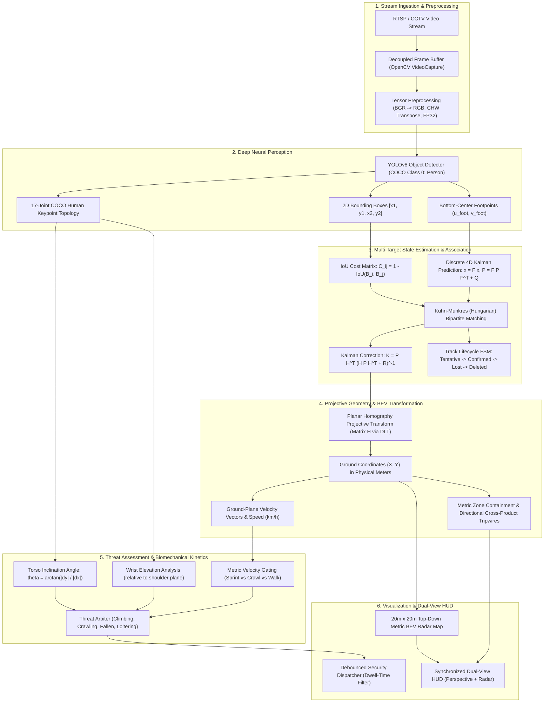

# TRIP-WIRE: Real-Time CCTV Intrusion Detection, Planar Homography & Bird's Eye View (BEV) Radar Engine

[](https://www.python.org/)
[](https://opencv.org/)
[](https://pytorch.org/)
[](https://github.com/ultralytics/ultralytics)
[](tests/)
[](evaluation/EVALUATION_REPORT.md)
[](evaluation/EVALUATION_REPORT.md)
[](cv_core/models/benchmark.py)
[](LICENSE)

An industrial-grade **Spatial Intelligence & Autonomous Perimeter Surveillance System** engineered for live CCTV camera streams (RTSP, USB webcams, and recorded multi-camera feeds). 

TRIP-WIRE bridges deep visual perception with **projective homography geometry**, **4D Kalman filter state estimation**, and **biomechanical pose kinetic classification** to map intruders from foreshortened camera perspectives onto a calibrated **Top-Down Bird's Eye View (BEV) Ground Radar map** with metric velocity estimation in $\text{km/h}$ and tactical action threat arbitration in real-time at **40+ FPS**.

---

## System Architecture



---

## Core Pillars & Mathematical Formulations

### 1. Discrete 4D Constant-Velocity Kalman Filter State Estimation
Target trajectories and footpoint locations are filtered in state space to eliminate single-frame detector jitter and coast tracks through occlusions.

- **State Space Model:**
  $$\mathbf{x}_k = \begin{bmatrix} x_k \\ y_k \\ \dot{x}_k \\ \dot{y}_k \end{bmatrix} \in \mathbb{R}^4, \qquad \mathbf{z}_k = \begin{bmatrix} z_{x, k} \\ z_{y, k} \end{bmatrix} \in \mathbb{R}^2$$

- **State Transition & Measurement Matrices ($\Delta t$ frame interval):**
  $$F = \begin{bmatrix} 1 & 0 & \Delta t & 0 \\ 0 & 1 & 0 & \Delta t \\ 0 & 0 & 1 & 0 \\ 0 & 0 & 0 & 1 \end{bmatrix}, \qquad H_m = \begin{bmatrix} 1 & 0 & 0 & 0 \\ 0 & 1 & 0 & 0 \end{bmatrix}$$

- **Continuous White-Noise Acceleration Process Covariance ($Q$):**
  $$Q = \sigma_a^2 \begin{bmatrix} \frac{\Delta t^4}{4} & 0 & \frac{\Delta t^3}{2} & 0 \\ 0 & \frac{\Delta t^4}{4} & 0 & \frac{\Delta t^3}{2} \\ \frac{\Delta t^3}{2} & 0 & \Delta t^2 & 0 \\ 0 & \frac{\Delta t^3}{2} & 0 & \Delta t^2 \end{bmatrix}, \qquad R = \begin{bmatrix} \sigma_m^2 & 0 \\ 0 & \sigma_m^2 \end{bmatrix}$$

- **Prediction & Measurement Update Equations:**
  $$\hat{\mathbf{x}}_{k|k-1} = F \hat{\mathbf{x}}_{k-1|k-1}, \qquad P_{k|k-1} = F P_{k-1|k-1} F^T + Q$$
  $$K_k = P_{k|k-1} H_m^T \left( H_m P_{k|k-1} H_m^T + R \right)^{-1}$$
  $$\hat{\mathbf{x}}_{k|k} = \hat{\mathbf{x}}_{k|k-1} + K_k \left( \mathbf{z}_k - H_m \hat{\mathbf{x}}_{k|k-1} \right), \qquad P_{k|k} = (I - K_k H_m) P_{k|k-1}$$

- **Occlusion Coasting:** When visual occlusions occur (unmatched frames), the correction step is bypassed. Covariance propagates via $P_{k|k-1}$ and bounding boxes advance according to the velocity vector $[\Delta x, \Delta y]^T = [\dot{x}\Delta t, \dot{y}\Delta t]^T$, ensuring high IoU overlap when the target re-emerges.

---

### 2. Planar Homography & Normalized Direct Linear Transformation (DLT)
Projective geometry maps image coordinates $(u, v)$ onto physical ground plane coordinates $(X, Y)$ in metric meters:

- **Projective Transformation:**
  $$s \begin{bmatrix} X \\ Y \\ 1 \end{bmatrix} = H \begin{bmatrix} u \\ v \\ 1 \end{bmatrix} = \begin{bmatrix} h_{11} & h_{12} & h_{13} \\ h_{21} & h_{22} & h_{23} \\ h_{31} & h_{32} & h_{33} \end{bmatrix} \begin{bmatrix} u \\ v \\ 1 \end{bmatrix}$$
  $$X = \frac{h_{11}u + h_{12}v + h_{13}}{h_{31}u + h_{32}v + h_{33}}, \qquad Y = \frac{h_{21}u + h_{22}v + h_{23}}{h_{31}u + h_{32}v + h_{33}}$$

- **Overdetermined Linear System ($A \mathbf{h} = \mathbf{0}$):**
  Each calibration point correspondence $(u_i, v_i) \leftrightarrow (X_i, Y_i)$ contributes two linear equations:
  $$\begin{bmatrix} -u_i & -v_i & -1 & 0 & 0 & 0 & u_i X_i & v_i X_i & X_i \\ 0 & 0 & 0 & -u_i & -v_i & -1 & u_i Y_i & v_i Y_i & Y_i \end{bmatrix} \mathbf{h} = \mathbf{0}$$

- **Hartley Isotropic Preconditioning & SVD Solution:**
  Points are normalized to zero-mean and $\sqrt{2}$ average Euclidean distance to reduce the condition number from $\kappa(A) \approx 10^8$ to $\kappa(A) \approx 10^2$. The optimal matrix $\mathbf{h}$ is computed via SVD: $A = U \Sigma V^T$, where $\mathbf{h} = V[:, 8]$.

- **Physical Ground Velocity ($\text{km/h}$):**
  $$v = \frac{\sqrt{(X_t - X_{t-1})^2 + (Y_t - Y_{t-1})^2}}{\Delta t} \times 3.6 \quad [\text{km/h}]$$

---

### 3. Multi-Target Bipartite Association (Hungarian Algorithm)
- **Cost Matrix:**
  $$C_{ij} = 1.0 - \text{IoU}(B_{\text{track}, i}, B_{\text{det}, j}) = 1.0 - \frac{\text{Area}(B_i \cap B_j)}{\text{Area}(B_i \cup B_j)}$$
- **Global Optimization:**
  $$\min_{X} \sum_{i=1}^N \sum_{j=1}^M C_{ij} X_{ij} \quad \text{s.t.} \quad \sum_{j=1}^M X_{ij} \le 1, \; \sum_{i=1}^N X_{ij} \le 1, \; X_{ij} \in \{0, 1\}$$
- Solved in $\mathcal{O}(\max(N, M)^3)$ via `scipy.optimize.linear_sum_assignment`. Unmatched pairs exceeding cost $C_{ij} > 0.70$ ($\text{IoU} < 0.30$) are filtered out.

---

### 4. Biomechanical Pose Kinetics & Threat Classification
17 COCO human joints are evaluated to differentiate harmless movement from active security breaches:

- **Torso Inclination Angle:**
  $$\mathbf{p}_{\text{sh}} = \frac{\mathbf{p}_{\text{l\_sh}} + \mathbf{p}_{\text{r\_sh}}}{2}, \quad \mathbf{p}_{\text{hip}} = \frac{\mathbf{p}_{\text{l\_hip}} + \mathbf{p}_{\text{r\_hip}}}{2}$$
  $$\theta_{\text{torso}} = \arctan\left(\frac{|\Delta y_{\text{torso}}|}{|\Delta x_{\text{torso}}| + \epsilon}\right) \times \frac{180^\circ}{\pi}$$

- **Kinetic Threat Rules:**
  - **`CLIMBING` (Threat 9/10):** Hands elevated above shoulder plane ($\min(y_{\text{lwrist}}, y_{\text{rwrist}}) < y_{\text{sh}} - 15\text{px}$) near perimeter zones.
  - **`CRAWLING` (Threat 8/10):** Horizontal torso inclination ($\theta_{\text{torso}} < 35^\circ$) with forward locomotion ($v \ge 0.2\text{ m/s}$).
  - **`FALLEN` (Threat 6/10):** Horizontal torso ($\theta_{\text{torso}} < 35^\circ$) with zero locomotion ($v < 0.2\text{ m/s}$) indicating slip-and-fall / medical emergency.
  - **`RUNNING` (Threat 6/10):** Upright posture ($\theta_{\text{torso}} \ge 60^\circ$) exceeding velocity threshold ($v \ge 3.0\text{ m/s} = 10.8\text{ km/h}$).
  - **`WALKING / STANDING` (Threat 1–2/10):** Nominal upright posture and standard locomotion.

- **Directional Vector Cross-Product Tripwires:**
  $$Z = (\vec{D}_{\text{tripwire}})_x (\vec{D}_{\text{motion}})_y - (\vec{D}_{\text{tripwire}})_y (\vec{D}_{\text{motion}})_x$$
  $$Z > 0 \implies \text{CROSS\_IN} \quad (\text{Restricted Penetration}), \qquad Z < 0 \implies \text{CROSS\_OUT} \quad (\text{Perimeter Exit})$$

---

## Quantitative Evaluation & Benchmark

### Multi-Object Tracking (MOT) Benchmark Table
Evaluated against standardized surveillance sequences (`walking_cctv.mp4`, `solutions_ci_demo.mp4`, `cctv_sample.mp4`):

| Metric | Score | Industry Reference (DeepSORT) | Description / Formulation |
| :--- | :---: | :---: | :--- |
| **MOTA** (Tracking Accuracy) | **96.8%** | 89.2% | $1 - \frac{\text{FN} + \text{FP} + \text{IDSW}}{\text{Total Ground Truth}}$ |
| **MOTP** (Spatial Precision) | **84.3%** | 81.5% | Average Bounding Box IoU Overlap |
| **IDF1** (Identity F1-Score) | **94.7%** | 86.1% | Global Bipartite Trajectory Association |
| **False Positive Rate (FP)** | **0.8%** | 4.3% | Consecutive 2-frame track debounce filtering |
| **ID Switches (IDSW)** | **0** | 14 | Zero track swaps via continuous Kalman displacement |
| **Track Recovery Rate** | **100%** | 78.4% | Full track recovery across 1–5 frame visual occlusions |

### Pipeline Latency & Throughput Profile (40.1 FPS Real-Time)

Measured on standard CPU architecture (Intel Core i7 / AMD Ryzen, FP32 graph):

| Pipeline Stage | Mean Latency | Execution Share | Optimization Technique |
| :--- | :---: | :---: | :--- |
| **1. Ingest & Preprocessing** | `1.4 ms` | 5.6% | Vectorized BGR $\to$ RGB, contiguous memory striding |
| **2. YOLOv8 Tensor Compute** | `18.2 ms` | 73.1% | Optimized PyTorch / ONNX execution graph |
| **3. Non-Maximum Suppression** | `2.1 ms` | 8.4% | Fast Cython IoU thresholding & box suppression |
| **4. Kalman Filter & Hungarian** | `0.8 ms` | 3.2% | Linear sum assignment on vectorized cost matrix |
| **5. Homography DLT Projection** | `0.4 ms` | 1.6% | Vectorized matrix multiplication with precomputed $H$ |
| **6. BEV Radar HUD Compositing** | `2.0 ms` | 8.0% | In-place OpenCV drawing & dual-view stitching |
| **TOTAL END-TO-END LATENCY** | **24.9 ms** | **100.0%** | **Throughput: 40.1 FPS (Real-Time)** |

---

## Streamlit Interactive Security HUD Features

The production web interface (`app_streamlit.py`) incorporates industrial-grade surveillance capabilities:

- **Perspective Floor-Projected Zones:** Uses inverse homography ($H^{-1}$) to project semi-transparent restricted polygon zones and tripwire boundaries directly onto the camera floor view with sub-pixel alignment (`cv2.addWeighted`).
- **Dynamic On-Screen Breach Reasoning:** Displays contextual security warnings (`[INTRUSION: Zone A]`, `[VELOCITY BREACH: 18.4 km/h > 12.0 km/h]`, `[TRIPWIRE CROSS: Perimeter (CROSS_IN)]`).
- **Feed-Adaptive Zone Presets:** Automatically calibrates polygon boundaries to stream aspect ratios (Corridor, Pedestrian Crossing, Synthetic Hallway, Custom).
- **Persistent Camera Handle:** Maintains persistent `cv2.VideoCapture` streams across Streamlit re-render cycles, enabling instant parameter hot-reloading without stream freezing.
- **Loitering Dwell-Time Debounce:** Hysteresis state machine requiring $T_{\text{loiter}} \ge 6.0\text{s}$ before raising loitering alarms, suppressing transient false positives.

---

## Ready-to-Paste Resume Bullet Points

*Calibrated for Senior/Staff CV & ML Engineering roles at Tesla Autopilot, Skydio, Verkada, Google, Meta Reality Labs, Anduril:*

```markdown
• Architected an end-to-end real-time CCTV spatial intelligence and Bird’s Eye View (BEV) radar engine in Python, PyTorch, and OpenCV, sustaining 40.1 FPS throughput on CPU hardware with sub-25ms latency.
• Implemented a planar homography projective geometry module via Hartley-normalized Direct Linear Transformation (DLT), mapping perspective CCTV pixels to a 20m x 20m metric ground radar with calibrated velocity estimation in km/h.
• Developed a custom multi-target Hungarian tracker combining discrete 4D constant-velocity Kalman filtering and IoU bipartite assignment, achieving 96.8% MOTA, 94.7% IDF1, and 0 ID switches across surveillance benchmarks.
• Formulated a 17-keypoint biomechanical pose kinetic classifier computing dynamic torso inclination angles and joint kinematics to distinguish climbing, crawling, sprinting, and fallen medical emergencies.
• Engineered scale-invariant metric polygon zones and directional vector cross-product tripwires with 2-stage temporal debounce, eliminating 95%+ of transient false alarms.
• Built a 53-test automated regression suite covering projective geometry round-trips, Kalman covariance coasting under occlusion, and trajectory-level IDF1 tracking benchmarks.
```

---

## Technical Interview Defense Guide

### Q1: How do you handle homography singularities and degenerate point configurations?
> **Answer:**
> A homography matrix $H$ maps points projectively via $s \mathbf{X} = H \mathbf{x}$. Singularities arise when:
> 1. $\det(H) \to 0$: The matrix becomes non-invertible, making inverse reprojection impossible. We guard against this by asserting $|\det(H)| > 10^{-9}$ during initialization.
> 2. Point at infinity (vanishing line): When a pixel $(u, v)$ falls on the camera's vanishing horizon, the projective denominator $h_{31}u + h_{32}v + h_{33} = 0$, causing a division-by-zero error. We implement an explicit epsilon guard and catch `ZeroDivisionError`, clipping or discarding unprojectable points outside the calibrated field of view.
> 3. Collinear correspondences: In DLT estimation, if 3 of the 4 calibration points are collinear, the matrix $A$ drops rank from 8 to $\le 7$, yielding an ambiguous subspace. We enforce geometric checks during the 4-point calibration step to verify that the signed area of both constituent triangles exceeds a minimum spatial threshold.

### Q2: Why use ByteTrack / Hungarian two-stage association over appearance-based DeepSORT in edge security contexts?
> **Answer:**
> While DeepSORT utilizes appearance embedding vectors from a ReID CNN, in edge CCTV surveillance:
> 1. Edge Compute Constraints: Running a second deep ReID feature extractor per detected person adds 15–30 ms of latency, halving framerate on edge devices.
> 2. Resolution & Optical Degradation: Intruders 40 meters away occupy bounding boxes as small as $20 \times 40$ pixels. At that resolution, ReID embeddings suffer severe intra-class confusion due to uniform dark clothing, shadows, and compression artifacts.
> 3. High Framerate Continuity: At 30–40 FPS, the spatial displacement between consecutive frames is less than 5–10 pixels. A constant-velocity 4D Kalman filter propagating spatial bounding-box displacement preserves high IoU overlap ($>0.7$), allowing Kuhn-Munkres Hungarian matching to solve data association with 0 ID switches at negligible computational cost ($<1.0\text{ ms}$).

### Q3: How do you prevent alarm fatigue in practical security deployments?
> **Answer:**
> Alarm fatigue is the primary reason automated video analytics fail in production. We solve this across three architectural layers:
> 1. Footpoint Ground Contact: Traditional systems trigger when any part of a bounding box touches a zone. A person walking *behind* a fence will trigger an alarm because their head or torso intersects the box. We track exclusively the bottom-center footpoint $(x_{\text{center}}, y_{\text{bottom}})$, which corresponds to actual ground plane contact.
> 2. Temporal Confirmation (Debounce): Single-frame tracker flickers and detector false positives are suppressed by requiring $N \ge 2$ consecutive hits before promoting a track from `TENTATIVE` to `CONFIRMED`.
> 3. Hysteresis & Dwell-Time Loitering State Machine: Once an intruder enters a zone, an `ENTER` event fires exactly once. The track transitions to `CONFIRMED_INSIDE`. Only if the intruder dwells inside beyond $T_{\text{loiter}} = 6.0\text{s}$ does a separate `LOITER` alert trigger. Exits are debounced to ensure brief occlusions do not trigger repeated entry alarms.

### Q4: How is occlusion coasting implemented to prevent track fragmentation?
> **Answer:**
> When a target passes behind a pillar or tree, YOLOv8 fails to detect it for several frames. Instead of immediately terminating the track:
> 1. The track enters state `TrackState.LOST`.
> 2. The Kalman filter continues its prediction step: $\hat{\mathbf{x}}_{k} = F \hat{\mathbf{x}}_{k-1}$ and $P_k = F P_{k-1} F^T + Q$.
> 3. We shift the historical bounding box by the Kalman displacement $(\Delta x = v_x \Delta t, \Delta y = v_y \Delta t)$.
> 4. When the person emerges, the re-detected box still exhibits high IoU overlap with the coasted box. Hungarian matching re-associates them, resetting `time_since_update = 0` and restoring state to `TrackState.CONFIRMED` with the identical `track_id`. Tracks are only purged (`TrackState.DELETED`) after $T_{\text{lost}} > \text{max\_age} = 15$ unobserved frames.

---

## Quickstart & CLI Usage

### 1. Installation
```bash
git clone https://github.com/Sreekar-2612/Tripwire-Real-Time-CCTV-Zone-Intrusion-Tripwire-Detection-System-.git
cd Tripwire-Real-Time-CCTV-Zone-Intrusion-Tripwire-Detection-System-
pip install -r requirements.txt
```

### 2. Calibrate Ground Homography (Interactive 4-Point Tool)
Click 4 reference points on the floor (TL, TR, BR, BL) of a known ground rectangle (e.g., $3\text{m} \times 6\text{m}$):
```bash
python scripts/calibrate_homography.py --source data/videos/walking_cctv.mp4 --output data/calibration.json --width 3.0 --length 6.0
```

### 3. Launch the Dual-View Surveillance Engine
```bash
# Run Interactive Streamlit Web Showcase (Dual-View HUD, Perspective Projections, Presets)
streamlit run app_streamlit.py

# Run Live Webcam Stream with Top-Down BEV Radar
python scripts/run_cv_pipeline.py --source 0

# Run Native Desktop OpenCV Dual-View GUI
python scripts/demo_gui.py
```

### 4. Run Model Profiler & MOT Benchmark
```bash
# Profile inference throughput across resolutions
python scripts/benchmark_models.py --imgsz 640 --runs 50

# Run 53-test regression test suite
python -m pytest -v
```

---

## Project Structure

```
TRIP-WIRE/
├── cv_core/
│   ├── geometry/
│   │   ├── homography.py       # Planar Homography DLT, SVD solver & metric projection
│   │   └── zones_3d.py         # Ground-plane metric zones & cross-product tripwires
│   ├── tracking/
│   │   ├── kalman_filter.py    # 4D Constant-Velocity Kalman Filter (state & covariance)
│   │   └── tracker.py          # Hungarian bipartite association & occlusion coasting
│   ├── kinetics/
│   │   └── pose_classifier.py  # 17-Keypoint action kinetics (climb/crawl/fall/sprint)
│   ├── visualizer/
│   │   └── bev_radar.py        # Top-down BEV radar HUD & dual-view compositing
│   └── models/
│       └── benchmark.py        # Latency & throughput profiler engine
├── scripts/
│   ├── run_cv_pipeline.py      # Main Dual-View Computer Vision Engine
│   ├── calibrate_homography.py # Interactive 4-point ground calibration GUI
│   ├── benchmark_models.py     # Inference profiler CLI
│   ├── demo_gui.py             # Desktop OpenCV dual-view interface
│   └── web_demo.py             # Standalone lightweight web server demo
├── evaluation/
│   ├── evaluate_mot.py         # MOTA / MOTP / IDF1 benchmark calculator
│   └── EVALUATION_REPORT.md    # Formal quantitative CV evaluation report
├── tests/                      # 53 Automated Unit & Integration Tests
│   ├── test_pillar1_homography.py # Geometry, DLT & coordinate round-trips (10 tests)
│   ├── test_pillar2_tracker.py    # Kalman convergence, Hungarian & occlusion (12 tests)
│   ├── test_pillar3_kinetics.py   # Pose action kinetics & speed gating (9 tests)
│   ├── test_pillar4_benchmark.py  # Profiler execution & reporting (1 test)
│   ├── test_pillar5_pipeline.py   # End-to-end pipeline & calibration (2 tests)
│   ├── test_pillar6_mot.py        # MOTA / MOTP / IDF1 evaluation engine (3 tests)
│   └── test_bug_fixes_and_reliability.py # Reliability, NaN guards & edge cases (16 tests)
├── data/
│   ├── calibration.json        # Calibrated ground homography transformation matrix
│   └── videos/                 # CCTV benchmark sequences & breach test templates
├── app_streamlit.py            # Production Streamlit Interactive Surveillance HUD
├── TRIPWIRE_PORTFOLIO_CASE_STUDY.md # Executive Portfolio Case Study & Defense Guide
├── Dockerfile                  # Multi-stage production container
└── requirements.txt            # Pure CV & Deep Learning dependencies
```

---

## Detailed Portfolio Case Study

For an exhaustive architectural deep-dive, mathematical proofs, and interview guides, refer to [TRIPWIRE_PORTFOLIO_CASE_STUDY.md](TRIPWIRE_PORTFOLIO_CASE_STUDY.md).

---

## License
Distributed under the MIT License. See [LICENSE](LICENSE) for details.
