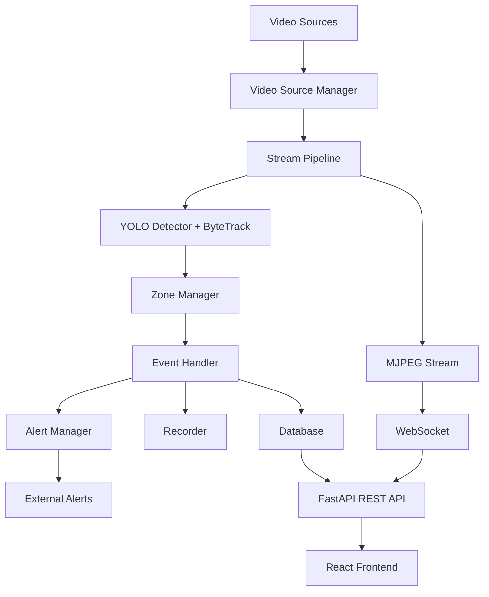

# Tripwire Architecture Documentation

## System Overview

Tripwire is a distributed system consisting of a Python FastAPI backend for video processing and a React TypeScript frontend for visualization and control.

## High-Level Architecture

## Backend Components

### Core Modules

#### 1. Video Sources (`core/sources.py`)
- `BaseVideoSource` - Abstract base class
- `OpenCVVideoSource` - OpenCV-based capture for RTSP/file/webcam
- Handles reconnection, looping, and frame reading

#### 2. Detector & Tracker (`core/detector.py`)
- `PersonDetectorTracker` - Wraps YOLOv8 with ByteTrack
- Filters to class 0 (person) only
- Maintains track history for trails
- GPU/CPU auto-detection

#### 3. Zone Management (`core/zones.py`)
- `ZoneGeometry` - Handles polygon and tripwire geometry
- `ZoneManager` - State machine for tracking persons in zones
- Debouncing logic (configurable frames)
- Cooldown periods
- Loitering detection
- Schedule-based arming
- Lost track handling

#### 4. Pipeline (`core/pipeline.py`)
- `StreamPipeline` - Main processing pipeline per stream
- Threading for concurrent processing
- Ring buffer for pre-event recording
- Frame annotation
- Event emission and handling
- Clip recording coordination

#### 5. Recorder (`core/recorder.py`)
- `FrameRingBuffer` - Circular buffer of recent frames
- `ClipRecorder` - Saves snapshots and video clips
- Async clip generation

#### 6. Alerts (`core/alerts.py`)
- `AlertManager` - Dispatches to multiple channels
- Telegram bot integration
- SMTP email
- Webhook HTTP POST

### API Layer

#### Routes
- `api/streams.py` - Stream CRUD, start/stop, MJPEG endpoint
- `api/zones.py` - Zone management per stream
- `api/events.py` - Event history, snapshots, clips
- `api/settings.py` - System configuration
- `api/ws.py` - WebSocket for real-time alerts

#### Database Models
- `Stream` - Video source configuration
- `Zone` - Zone definitions (polygon/tripwire)
- `Event` - Intrusion events with metadata
- `SystemSetting` - Key-value configuration

## Frontend Components

### Pages
- `LiveMonitorPage` - Main monitoring interface with video, zones, events
- `SourcesPage` - Stream management
- `EventsPage` - Event history and playback
- `SettingsPage` - System configuration

### Components
- `Navbar` - Navigation and status
- `VideoPlayer` - MJPEG stream display with zone overlay
- `ZoneEditor` - Interactive zone drawing
- `AlarmToast` - Alert notifications
- `SnapshotModal` - Image preview

### Hooks
- `useAlertWebSocket` - WebSocket connection management
- `useAlertAudio` - Audio alert playback

## Data Flow

### Detection Flow
1. Frame captured from video source
2. Frame stored in ring buffer
3. Frame sent to YOLO + ByteTrack (every N frames if frame skipping enabled)
4. Detections tracked with IDs
5. Each track checked against all active zones
6. State machine evaluates transitions (outside→inside, inside→outside)
7. Events generated on confirmed transitions
8. Frame annotated with overlays
9. Annotated frame sent to MJPEG stream

### Event Processing Flow
1. Event detected by zone manager
2. Printed to console
3. Saved to database
4. Snapshot captured and saved
5. Pre-event frames retrieved from ring buffer
6. Async clip recording started (pre + post buffer)
7. WebSocket broadcast sent
8. External alerts dispatched (if configured)
9. UI updated via WebSocket

## Performance Considerations

### Backend
- **Threading**: Each stream runs in its own thread
- **Frame Skipping**: Optional to reduce CPU/GPU load
- **Ring Buffer**: Fixed-size to limit memory usage
- **GPU Acceleration**: Automatic CUDA detection
- **Async Operations**: Non-blocking I/O where possible

### Frontend
- **MJPEG Streaming**: Efficient for real-time video
- **WebSocket**: Low-latency alerts
- **Component Optimization**: React.memo where appropriate
- **Lazy Loading**: Code splitting ready

## Security Considerations

- **CORS**: Currently allows all origins (should be restricted in production)
- **No Authentication**: Currently open access (planned for future)
- **File Uploads**: Validated but could use more restrictions
- **RTSP Credentials**: Stored in plain text in DB (consider encryption)
- **API Rate Limiting**: Not implemented (planned)

## Scalability

Current design supports:
- Multiple streams on single machine
- Configurable resource usage
- Horizontal scaling possible with load balancer (needs shared storage/DB)

Limitations:
- SQLite is single-writer (use PostgreSQL for multi-instance)
- In-memory pipeline state (lost on restart)
- No distributed processing

## Technology Decisions

| Decision | Rationale |
|----------|-----------|
| YOLOv8n | Good balance of speed and accuracy for person detection |
| ByteTrack | Robust tracking, handles occlusions well |
| FastAPI | Modern async framework, automatic API docs |
| React + TypeScript | Type safety, great ecosystem |
| MJPEG over WebRTC | Simpler implementation, works in most browsers |
| SQLite | Easy setup, no separate DB server needed |
| Shapely | Reliable geometric operations |

## Future Improvements

See [ENHANCEMENT_PLAN.md](../ENHANCEMENT_PLAN.md) for detailed roadmap.
